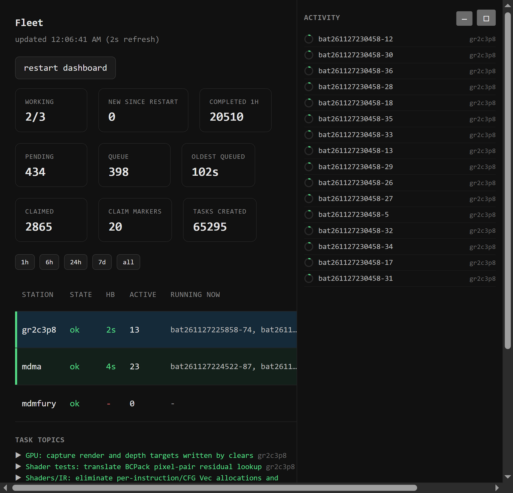

# Monitoring: what to measure, and what the numbers actually mean

*The board as it ran on 2026-11-27: KPI row, window buttons, per-station table, a live activity rail on the
right, and the task-topic list beneath. The `gr2c3p8` row is selected, so both lists show only that
station's work.*

Written 2026-11-27 after a session in which nearly every wrong conclusion came from a correctly
measured number read at the wrong scope. The lesson is not 'monitor more'; it is that a number is
only meaningful with its unit, its window, its clock and its base.

## The four figures

| figure | definition | unit |
|---|---|---|
| `created` | cumulative task documents written to `queue/` | dispatches, since start |
| `done 15m` | result files written in the last 15 minutes | dispatches, rolling window |
| `pending` | `queue` + sum of per-station `active` | dispatches, instant |
| `claims outstanding` | task files in `claimed/` not yet archived | dispatches, up to one lease old |

The identity that should hold, and that you can check: `created = done + pending + archived`.
If it does not hold, one of the four is in the wrong unit, and the board is lying to you.

## Four ways these numbers lie

1. **Unit drift.** A batch task covering 12 issues is one dispatch. A counter that increments per
   issue reports twelve times the dispatches. Both look plausible; only one reconciles with
   `done`. Keep one counter and increment it once per task document.
2. **Window drift.** `done 15m` is a window; `created` is a total. Comparing them directly is
   meaningless, and the ratio changes with load rather than with health.
3. **Clock drift.** Comparing a UTC `now` against a local file timestamp silently widens the
   window by the UTC offset. A '15 minute' figure measured this way covered 75 minutes and
   reported 117 completions where the true answer was 0.
4. **Cache drift.** A `/health` cache of 8 s on a counter moving ~100 per 8 s means two observers
   reading the same minute see different numbers. Either pin the reading to the counter's own
   timestamp, or publish the cache age next to the value.

## Reading utilisation honestly

`active / slots` is the fraction of slots mid-task at the instant of sampling. It is bounded by
`task duration / claim round-trip`, not by how much work the station does. Measured here:

| station | slots | peak active | completions/s | reading |
|---|---|---|---|---|
| mdma | 32 | 25 | 8.2 | fastest station, lowest ratio |
| gr2c3p8 | 16 | 16 | 7.1 | saturated |
| mdmfury | 16 | 0-15 | 0.7 | parked by policy, not idle by fault |

A station doing the most work can score the worst utilisation. Use completions per minute as the
headline and utilisation as a shape indicator, never as a productivity score.

## Claim residue is not work in flight

Claims are archived by the reaper only after a lease (600 s by default). At ~26 completions/s that
leaves roughly 10,000-15,000 finished tasks sitting in `claimed/`, and a monitor with an absolute
threshold sized for a slow fleet reports `healthy=false` permanently. Either size the threshold to
the observed distribution, or shorten the lease for tasks that already have a result. Do not
'fix' it by suppressing the anomaly.

## Instrumentation that works

- Per-station heartbeat carries `active` and the live task `ids`; it is small, cheap and cannot
  drift from reality because the agent writes it from its own runspace table.
- Completions are appended by the worker to `status/events.log` as `ts|node|id|exit|ms`. Reading
  the tail of one file beats scanning 30,000 result files on every dashboard refresh.
- Measured consequence: scanning the share per request made `/health` take >20 s and the
  dashboard time out; the heartbeat-plus-log version answers in 2-3 ms.

## Thresholds should be derived, not chosen

Sample the four figures once a minute into a CSV and set thresholds from the observed
distribution: the 95th percentile of `claims outstanding`, the usual `queue` band, the median
completion rate. Any threshold picked during a single burst encodes that burst.

## Operator controls

The board is also a control surface. Four buttons sit above the KPIs, plus one alarm:

| control | effect |
|---|---|
| `refill` | runs the finder immediately instead of waiting for its pass |
| `pause` | the feeder stops creating tasks; running work finishes |
| `resume` | clears both pause and drain |
| `drain` | stops creating, lets the queue empty, does not resume by itself |
| `alarm` | immediate recovery: clears stale claim markers, starts a new verification cycle if supply is exhausted, kicks the finder, and restarts the local agent if nothing has completed in five minutes |

Every control writes a state file under `control/` that the feeder and the queue monitor read on their
next pass (sub-second), and is logged to `status/events.log` and `status/queue-monitor.log`. The
controls require the restart token, which the page already holds - a control surface without an auth
check would be a remote kill switch for anyone on the LAN.

`FleetQueueMonitor.ps1` runs every minute on the coordinator and is the piece that keeps an empty
queue honest: it distinguishes **refilling** (supply remains) from **exhausted** (nothing left to
create), logs one line per minute for graphing, and writes `status/queue-alert.txt` only in the second
case. An empty queue therefore always has exactly one of two meanings, and they are not the same.
